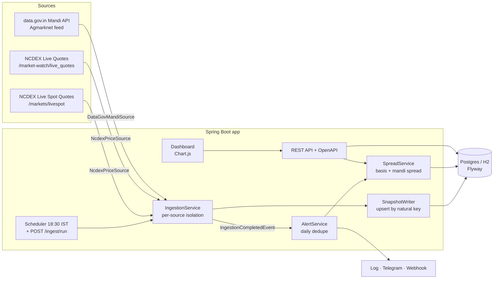

# commodity-spot-tracker

[](https://github.com/soham-023/commodity-spot-tracker/actions/workflows/ci.yml)

A Spring Boot service that records **turmeric (हळद) prices every day** from the NCDEX exchange and from APMC mandis, keeps the history, measures the gap between them and raises an alert when the gap gets unusually wide.

## The problem

Turmeric has three prices that should move together and often don't:

| Price | Where it comes from | What it is |
| --- | --- | --- |
| **NCDEX spot** | Polled by NCDEX from traders at Nizamabad (Farmer Polished, Unpolished) and Sangli (Rajapore) | The reference price futures settle against |
| **NCDEX futures** (`TMCFGRNZM`) | Exchange trading | What the market expects for the delivery month |
| **APMC modal price** | Agmarknet, the price farmers actually got at Nizamabad, Sangli, Erode, Hingoli, Basmat, Warangal | The cash market |

When they drift apart, farmers selling at the mandi and small traders hedging on NCDEX can't see it. Nobody shows the three side by side. NCDEX's spot poll also goes stale: on 11 Nov 2026 the live page still showed the Nizamabad poll from **4 Nov** while the December contract traded about **14% above it**. This project makes that gap visible and alerts on it.

## What it does

- **Ingests daily** at 18:30 IST (configurable), after agri futures close, plus `POST /api/v1/ingest/run` on demand. A failing source is logged and reported; the others still run.
- **Stores history idempotently.** Each `PriceSnapshot` is unique on `(source, market, variety, type, contract month, date)`, so a re-run updates rather than duplicates.
- **Computes spreads**:
  - *Basis* = near-month futures − NCDEX Farmer Polished spot (Nizamabad)
  - *Mandi spread* = APMC modal price (averaged across varieties) − NCDEX spot

  Stale spot polls are used for up to 7 days, and every spread records which poll it used.
- **Flags** a spread wider than **5%** of spot (`WIDE_SPREAD`) or a compared price that moves more than **3%** day over day (`SHARP_MOVE`).
- **Alerts** through the log, a Telegram bot or any JSON webhook, with at most one alert per flag per day.
- **REST API** with OpenAPI docs, plus a **Chart.js dashboard**.

## Architecture



Every source implements one interface:

```java
public interface PriceSource {
    String id();
    boolean isEnabled();
    List<PriceSnapshot> fetch() throws Exception;
}
```

Adding a source (eNAM, a state APMC portal, a CSV drop) means writing one class.

## Data sources

| Source | Status | Needs |
| --- | --- | --- |
| NCDEX Live Spot Quotes (`https://www.ncdex.com/markets/livespot`) | **Works live.** Public, server-rendered HTML parsed with jsoup. | Nothing |
| NCDEX Live Quotes (`https://www.ncdex.com/market-watch/live_quotes`) | **Works live.** All `TMCFGRNZM` expiries; last traded price, low and high. | Nothing |
| data.gov.in resource [`9ef84268-d588-465a-a308-a864a43d0070`](https://data.gov.in/apis/9ef84268-d588-465a-a308-a864a43d0070) | Implemented and tested against the documented schema. **Disabled until you set a key.** | `DATA_GOV_API_KEY` |

Get a free data.gov.in key by signing up at <https://data.gov.in> and choosing *Generate API key*. data.gov.in also publishes a shared sample key on its API pages, but it returns only 10 records per call, so use your own. Never commit a key; pass it as an environment variable.

The parsers are tested against fixtures in `src/test/resources/fixtures`. The NCDEX pages there were **recorded** on 11 Nov 2026. The mandi JSON is **synthetic**: it follows the API schema, but its prices are illustrative. See [fixtures/README](src/test/resources/fixtures/README.md).

## Run it

Requires Java 21 (Maven Wrapper not included; use Maven 3.9+).

**1. Offline demo, with no keys or network.** This loads synthetic history plus the recorded NCDEX pages:

```bash
mvn spring-boot:run -Dspring-boot.run.profiles=demo
# Dashboard  http://localhost:8080/
# API docs   http://localhost:8080/swagger-ui.html
```

**2. Local with live sources** (H2 file database in `./data`):

```bash
export DATA_GOV_API_KEY=your-key   # optional; without it only NCDEX runs
mvn spring-boot:run
curl -X POST http://localhost:8080/api/v1/ingest/run
```

**3. Docker with Postgres:**

```bash
cp .env.example .env               # fill in keys if you have them
docker compose up --build
```

## API

| Method | Path | Notes |
| --- | --- | --- |
| `GET` | `/api/v1/prices` | Filters: `commodity`, `source` (`NCDEX`/`AGMARKNET`), `market`, `type` (`SPOT`/`FUTURES`), `from`, `to`; paging with `page` and `size` (max 500). Default window is 90 days. |
| `GET` | `/api/v1/spreads` | `kind` (`BASIS`/`MANDI`), `flaggedOnly`, `from`, `to` |
| `GET` | `/api/v1/alerts` | `from`, `page`, `size` |
| `GET` | `/api/v1/summary` | Latest spot, futures, mandis, spreads and alerts. Returns 404 if the commodity has no data. |
| `POST` | `/api/v1/ingest/run` | Runs every enabled source now and reports OK, FAILED or SKIPPED for each |

Errors are RFC 9457 problem details. Invalid parameters or a `from` after `to` return 400; unknown data returns 404.

```bash
curl "http://localhost:8080/api/v1/spreads?kind=BASIS&flaggedOnly=true"
```

## Configuration

| Env var | Default | Purpose |
| --- | --- | --- |
| `SPOT_DB_URL` | H2 file `./data/spottracker` | JDBC URL, e.g. `jdbc:postgresql://localhost:5432/spottracker` |
| `SPOT_DB_USER` / `SPOT_DB_PASSWORD` | `sa` / empty | Database credentials |
| `SPOT_INGEST_CRON` | `0 30 18 * * *` | Spring cron, evaluated in Asia/Kolkata |
| `SPOT_SCHEDULER_ENABLED` | `true` | Turns the daily job off (the manual endpoint still works) |
| `SPOT_NCDEX_ENABLED` | `true` | NCDEX source on or off |
| `DATA_GOV_API_KEY` | empty | Turns the APMC mandi source on |
| `SPOT_MANDI_MARKETS` | `Nizamabad,Sangli,Erode,Hingoli,Basmat,Warangal` | Mandi names to keep (case-insensitive substring match) |
| `SPOT_SPREAD_THRESHOLD_PCT` | `5` | `WIDE_SPREAD` threshold, as % of NCDEX spot |
| `SPOT_DAY_MOVE_PCT` | `3` | `SHARP_MOVE` threshold, as % day-over-day change |
| `TELEGRAM_BOT_TOKEN` / `TELEGRAM_CHAT_ID` | empty | Turns the Telegram channel on |
| `ALERT_WEBHOOK_URL` | empty | Turns the JSON webhook channel on (works with Slack-style `text` payloads) |

## Build and test

```bash
mvn -B verify
```

The test suite has 40 tests:

- **Parsers:** run against the recorded NCDEX pages and the mandi JSON.
- **Spreads:** basis, stale spot handling, thresholds and day-over-day moves.
- **Alerts:** dedupe, and a failing channel not blocking the others.
- **API:** WebMvc tests for 200, 400 and 404 responses.
- **Repository:** idempotency against the real Flyway schema.
- **Demo profile:** a full Spring Boot run end to end.

## Tech

Java 21 · Spring Boot 3.4 (Web, Data JPA, Validation, Actuator) · Flyway · PostgreSQL / H2 · jsoup · springdoc-openapi · Chart.js · JUnit 5, Mockito, AssertJ · Docker · GitHub Actions

## Disclaimer

NCDEX spot prices are published for information only. This project is not trading advice. Check prices with the exchange and the APMC before acting on them.

## License

[MIT](LICENSE)
