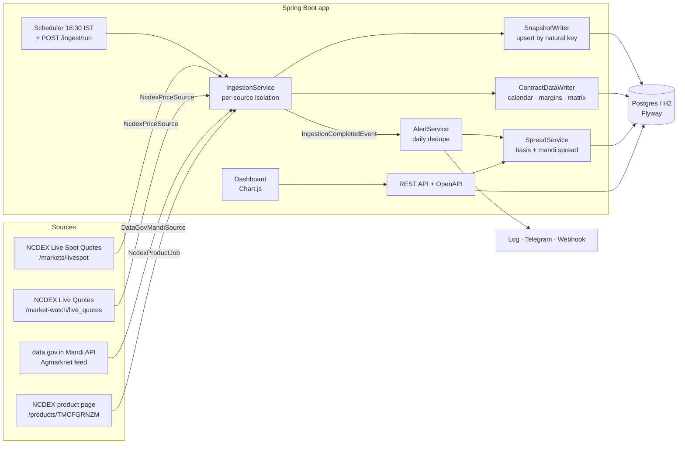

# commodity-spot-tracker

[](https://github.com/soham-023/commodity-spot-tracker/actions/workflows/ci.yml)

A Spring Boot service that records **turmeric (हळद) prices every day** from the NCDEX exchange and from APMC mandis, keeps the history, measures the gap between them and raises an alert when the gap gets unusually wide.

## The problem

Turmeric has three prices that should move together and often don't:

| Price | Where it comes from | What it is |
| --- | --- | --- |
| **NCDEX spot** | Polled by NCDEX from traders at Nizamabad (Farmer Polished, Unpolished) and Sangli (Rajapore) | The reference price futures settle against |
| **NCDEX futures** (`TMCFGRNZM`) | Exchange trading | What the market expects for the delivery month |
| **APMC modal price** | Agmarknet, the price farmers actually got at Nizamabad, Sangli, Erode, Hingoli, Basmat, Warangal | The cash market |

When they drift apart, farmers selling at the mandi and small traders hedging on NCDEX can't see it. Nobody shows the three side by side. NCDEX's spot poll also goes stale: on 11 Nov 2026 the live page still showed the Nizamabad poll from **4 Nov** while the December contract traded about **14% above it**. This project makes that gap visible and alerts on it.

## What it does

- **Ingests daily** at 18:30 IST (configurable), after agri futures close, plus `POST /api/v1/ingest/run` on demand. A failing source is logged and reported; the others still run.
- **Stores history idempotently.** Each `PriceSnapshot` is unique on `(source, market, variety, type, contract month, date)`, so a re-run updates rather than duplicates.
- **Reads the NCDEX product page** (`/products/TMCFGRNZM`) every run: the contract calendar (active expiries), the daily margin table per expiry and the delivery premium/discount matrix.
- **Computes spreads**:
  - *Basis* = near-month futures − NCDEX Farmer Polished spot (Nizamabad), the contract's basis quality
  - *Delivery basis* = near-month futures − each other NCDEX-polled deliverable grade (Unpolished at Nizamabad, Rajapore at Sangli)
  - *Mandi spread* = APMC modal price (averaged across varieties) − NCDEX spot

  The **near month comes from the scraped expiry calendar**: a contract stops being used `SPOT_ROLL_DAYS` (5) calendar days before it expires. Stale spot polls are used for up to 7 days, and every spread records which poll it used.
- **Delivery-adjusts spreads** with the NCDEX premium/discount matrix (see below) and keeps the raw spread next to it.
- **Flags** a spread wider than **5%** of spot (`WIDE_SPREAD`, judged on the delivery-adjusted spread when there is one) or a compared price that moves more than **3%** day over day (`SHARP_MOVE`).
- **Watches exchange margins**: a near-month total margin (TM) move of more than **2 points** from the previous margin date, such as an imposed additional margin, raises a `MARGIN_CHANGE` alert.
- **Alerts** through the log, a Telegram bot or any JSON webhook, with at most one alert per flag per day.
- **REST API** with OpenAPI docs, plus a **Chart.js dashboard**.

## Architecture



Every source implements one interface:

```java
public interface PriceSource {
    String id();
    boolean isEnabled();
    List<PriceSnapshot> fetch() throws Exception;
}
```

Adding a source (eNAM, a state APMC portal, a CSV drop) means writing one class. Non-price data (the product page) runs as a `ReferenceDataJob` before the price sources, so spread analysis always sees the current contract calendar.

## Delivery-adjusted basis

NCDEX's turmeric contract delivers **Farmer polished fingers, Nizamabad quality, at Nizamabad** (the basis). Other grades are deliverable at a premium or discount published in the product page's *Premium Discount Matrix*. A Rajapore quote from Sangli is *supposed* to sit about 4% above the basis grade, so comparing it with futures as-is reports a gap the exchange already prices in.

The tracker converts each quote to its basis-quality equivalent before comparing it with futures:

```
basis equivalent = spot / (1 + premium% / 100)
adjusted spread  = futures − basis equivalent          (delivery basis)
adjusted spread  = modal / (1 + premium% / 100) − spot (mandi spread)
```

Matrix as published on 11 Nov 2026 (margin date 11-Nov-26):

| Delivery location | Dec-26 | Apr-27 | May-27 | Spot ÷ |
| --- | --- | --- | --- | --- |
| Farmer polished fingers Nizamabad quality at Nizamabad | basis | basis | basis | 1.00 |
| Unpolished Fingers at Nizamabad | −4% | not deliverable | not deliverable | 0.96 |
| Rajapore quality at Sangli | +4% | +4% | +4% | 1.04 |
| Erode quality at Erode | 0 | 0 | 0 | 1.00 |
| Salem quality at Erode | +2% | +2% | +2% | 1.02 |
| Salem quality at Basmat | 0 | 0 | 0 | 1.00 |

Example from the recorded pages: Rajapore at Sangli polled ₹28,650 → ₹27,548 basis equivalent; Unpolished at Nizamabad ₹23,698.55 → ₹24,686.

Rules worth knowing:

- The matrix of the **near-month expiry** is used (an expiry the matrix doesn't list falls back to the nearest later one). The latest published matrix is applied to the whole history window.
- NCDEX spot grades match by quality and centre. Mandi averages match by variety (Agmarknet's "Rajapuri" = Rajapore) or, failing that, by a centre with a single deliverable quality (Sangli → Rajapore, Basmat → Salem). Erode (two qualities) and Nizamabad mandi "Finger" stay unadjusted, and Hingoli/Warangal aren't delivery centres; those points keep `adjustedSpread = null` and are flagged on the raw spread.
- Every point exposes both: `spread`/`spreadPct` (raw) and `adjustmentPct`, `adjustedSpread`, `adjustedSpreadPct`.

## Data sources

| Source | Status | Needs |
| --- | --- | --- |
| NCDEX Live Spot Quotes (`https://www.ncdex.com/markets/livespot`) | **Works live.** Public, server-rendered HTML parsed with jsoup. | Nothing |
| NCDEX Live Quotes (`https://www.ncdex.com/market-watch/live_quotes`) | **Works live.** All `TMCFGRNZM` expiries; last traded price, low and high. | Nothing |
| NCDEX product page ([`https://www.ncdex.com/products/TMCFGRNZM`](https://www.ncdex.com/products/TMCFGRNZM)) | **Works live.** Server-rendered tables: active expiries (union of the futures selector, margin table and matrix), *Daily margin information* (IM, ELM, Add. PEM, TM, Add. Long/Short, SPCML/SPCMS in % of contract value) and the *Premium Discount Matrix*. Stored in `contract_expiry`, `daily_margin` and `premium_discount`, upserted per date/expiry/location. | Nothing |
| NCDEX Futures Prices history (`/markets/futureprices` → `POST /futureprices/filters`, `POST /futureprices/get_data`) | **Implemented, tested on recorded responses.** Daily OHLC per `TMCFGRNZM` expiry. Each POST needs the session cookie from a GET of the page, its `csrf-token` as `_token`, `X-Requested-With` and a Referer; `length=-1` breaks the server, so the source asks for 2,000 rows. | Nothing |
| NCDEX Spot Prices history (`/markets/spotprices` → `POST /spotprices/price_graph`) | **Implemented, tested on recorded responses.** Polled spot for Farmer Polished (TMCFGRNZM), Unpolished (TMCFUPNZM) and Rajapore (TMCRJPSGL). NCDEX serves only ~30 days back. | Nothing |
| data.gov.in resource [`9ef84268-d588-465a-a308-a864a43d0070`](https://data.gov.in/apis/9ef84268-d588-465a-a308-a864a43d0070) | Implemented and tested against the documented schema. **Disabled until you set a key.** | `DATA_GOV_API_KEY` |

Get a free data.gov.in key by signing up at <https://data.gov.in> and choosing *Generate API key*. data.gov.in also publishes a shared sample key on its API pages, but it returns only 10 records per call, so use your own. Never commit a key; pass it as an environment variable.

The product page also links the contract specification and product note zips, historical futures/spot prices and circulars (contract specification changes, pre-expiry margins, *Imposition of Additional Margin*); those are not parsed — the margin alert picks up the effect of an additional-margin circular from the margin table itself.

The parsers are tested against fixtures in `src/test/resources/fixtures`. The NCDEX pages there were **recorded** on 11 Nov 2026. The mandi JSON is **synthetic**: it follows the API schema, but its prices are illustrative. See [fixtures/README](src/test/resources/fixtures/README.md).

### Real data shipped with the app

`src/main/resources/seed/` holds real NCDEX turmeric prices downloaded on 12 Nov 2026 (details in
[seed/README](src/main/resources/seed/README.md)). On the default profile `SeedDataLoader` loads them when the
price table is empty, so the dashboard opens with data. Nothing in it is synthetic.

| Series | Range | Rows |
| --- | --- | --- |
| TMCFGRNZM futures, all 34 expiries (close, low, high) | 2022-01-03 → 2026-11-11 | 4,121 |
| Spot, Farmer Polished Nizamabad: bhavcopy underlying + polls | 2025-11-10 → 2026-11-11 | 193 |
| Spot, Unpolished Nizamabad (polls) | 2026-10-09 → 2026-11-11 | 17 |
| Spot, Rajapore Sangli (polls) | 2026-10-08 → 2026-11-11 | 22 |

Older Farmer Polished spot comes from the `UndrlygPric` column of the daily final bhavcopy, which repeats the
last poll on days NCDEX did not poll. Spot before Nov 2025 is not included (futures are).

## Run it

Requires Java 21 (Maven Wrapper not included; use Maven 3.9+).

**1. Offline demo, with no keys or network.** This loads synthetic history plus the recorded NCDEX pages:

```bash
mvn spring-boot:run -Dspring-boot.run.profiles=demo
# Dashboard  http://localhost:8080/
# API docs   http://localhost:8080/swagger-ui.html
```

**2. Local with real data and live sources** (H2 file database in `./data`):

```bash
export DATA_GOV_API_KEY=your-key   # optional; without it only NCDEX runs
mvn spring-boot:run
# First start on an empty DB loads the real NCDEX seed (2022 → 11 Nov 2026), then a background
# startup ingest backfills the last 30 days and runs the live sources.
curl -X POST "http://localhost:8080/api/v1/ingest/backfill?from=2026-10-01"   # any range, re-runnable
curl -o turmeric.csv "http://localhost:8080/api/v1/prices/export.csv?from=2022-01-01"
```

Delete `./data` to start over; the seed loads again on the next start.

**3. Docker with Postgres:**

```bash
cp .env.example .env               # fill in keys if you have them
docker compose up --build
```

## API

| Method | Path | Notes |
| --- | --- | --- |
| `GET` | `/api/v1/prices` | Filters: `commodity`, `source` (`NCDEX`/`AGMARKNET`), `market`, `type` (`SPOT`/`FUTURES`), `from`, `to`; paging with `page` and `size` (max 500). Default window is 90 days. |
| `GET` | `/api/v1/spreads` | `kind` (`BASIS`/`DELIVERY`/`MANDI`), `flaggedOnly`, `from`, `to`. Raw and delivery-adjusted values per point. |
| `GET` | `/api/v1/contracts` | `symbol` (default `TMCFGRNZM`). Active expiries, days to expiry, near month, roll-window state, latest daily margins and the TM change vs the previous margin date. 404 before the first product-page scrape. |
| `GET` | `/api/v1/premium-discount` | `symbol`, optional `expiry` (ISO date). Latest matrix with `premiumPct` and the basis-equivalent `divisor`. |
| `GET` | `/api/v1/alerts` | `from`, `page`, `size` |
| `GET` | `/api/v1/summary` | Latest spot, futures, mandis, spreads and alerts. Returns 404 if the commodity has no data. |
| `GET` | `/api/v1/prices/status` | Row count, first/last price date, last update time and futures contract months |
| `GET` | `/api/v1/prices/export.csv` | Every price in `from`..`to` (default 90 days) as CSV, oldest first; optional `type` and `contract` (`yyyy-MM`) |
| `POST` | `/api/v1/ingest/run` | Runs every enabled source now and reports OK, FAILED or SKIPPED for each |
| `POST` | `/api/v1/ingest/backfill` | `from`, `to` (default last 30 days). NCDEX futures history for every expiry trading in the range, plus spot history (~30 days served). Upserts. |

Errors are RFC 9457 problem details. Invalid parameters or a `from` after `to` return 400; unknown data returns 404.

```bash
curl "http://localhost:8080/api/v1/spreads?kind=BASIS&flaggedOnly=true"
```

## Configuration

| Env var | Default | Purpose |
| --- | --- | --- |
| `SPOT_DB_URL` | H2 file `./data/spottracker` | JDBC URL, e.g. `jdbc:postgresql://localhost:5432/spottracker` |
| `SPOT_DB_USER` / `SPOT_DB_PASSWORD` | `sa` / empty | Database credentials |
| `SPOT_INGEST_CRON` | `0 30 18 * * *` | Spring cron, evaluated in Asia/Kolkata |
| `SPOT_SCHEDULER_ENABLED` | `true` | Turns the daily job off (the manual endpoint still works) |
| `SPOT_NCDEX_ENABLED` | `true` | NCDEX live and history sources on or off |
| `SPOT_SEED_ENABLED` | `true` | Load the shipped real NCDEX history when the price table is empty (default profile only) |
| `SPOT_INGEST_ON_STARTUP` | `true` | Background ingest after startup: backfill, then the live sources (default profile only) |
| `SPOT_STARTUP_BACKFILL_DAYS` | `30` | Days of NCDEX history the startup ingest backfills (0 = skip backfill) |
| `SPOT_NCDEX_PRODUCT_ENABLED` | `true` | NCDEX product page (calendar, margins, premium/discount matrix) on or off |
| `SPOT_ROLL_DAYS` | `5` | Calendar days before expiry at which the near month rolls to the next contract |
| `SPOT_MARGIN_ALERT_POINTS` | `2` | `MARGIN_CHANGE` threshold: near-month TM change in percentage points of contract value |
| `DATA_GOV_API_KEY` | empty | Turns the APMC mandi source on |
| `SPOT_MANDI_MARKETS` | `Nizamabad,Sangli,Erode,Hingoli,Basmat,Warangal` | Mandi names to keep (case-insensitive substring match) |
| `SPOT_SPREAD_THRESHOLD_PCT` | `5` | `WIDE_SPREAD` threshold, as % of NCDEX spot |
| `SPOT_DAY_MOVE_PCT` | `3` | `SHARP_MOVE` threshold, as % day-over-day change |
| `TELEGRAM_BOT_TOKEN` / `TELEGRAM_CHAT_ID` | empty | Turns the Telegram channel on |
| `ALERT_WEBHOOK_URL` | empty | Turns the JSON webhook channel on (works with Slack-style `text` payloads) |

## Build and test

```bash
mvn -B verify
```

The test suite has 73 tests:

- **Parsers:** run against the recorded NCDEX pages (including the product page) and the mandi JSON.
- **Spreads:** basis, stale spot handling, thresholds, day-over-day moves, calendar-based roll and delivery adjustment.
- **Contracts:** expiry calendar, premium/discount lookup, margin change, idempotent upserts on the real schema.
- **Alerts:** dedupe, margin alerts, and a failing channel not blocking the others.
- **API:** WebMvc tests for 200, 400 and 404 responses.
- **Repository:** idempotency against the real Flyway schema.
- **Demo profile:** a full Spring Boot run end to end.

## Tech

Java 21 · Spring Boot 3.4 (Web, Data JPA, Validation, Actuator) · Flyway · PostgreSQL / H2 · jsoup · springdoc-openapi · Chart.js · JUnit 5, Mockito, AssertJ · Docker · GitHub Actions

## Disclaimer

NCDEX spot prices are published for information only. This project is not trading advice. Check prices with the exchange and the APMC before acting on them.

## License

[MIT](LICENSE)
